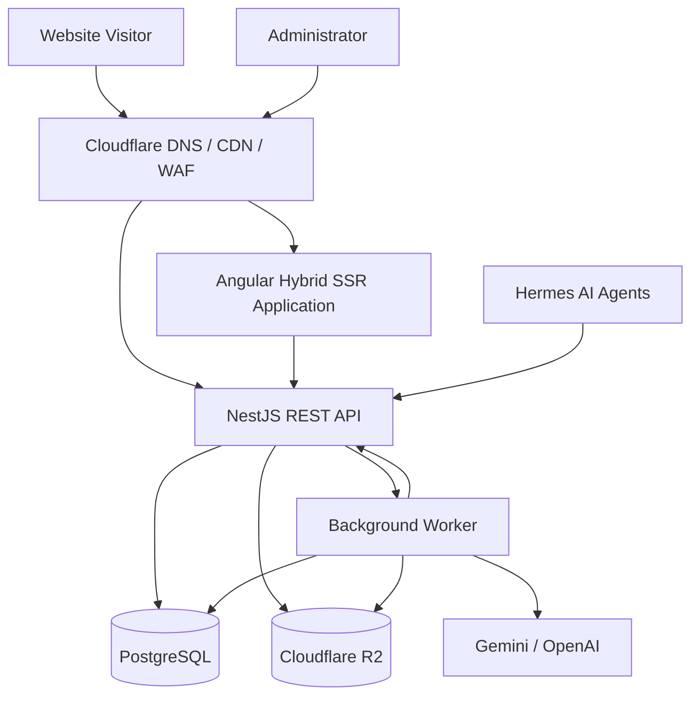
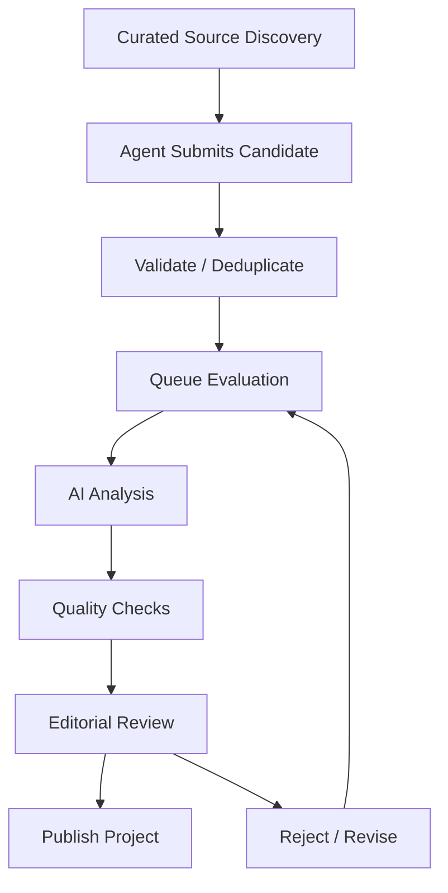
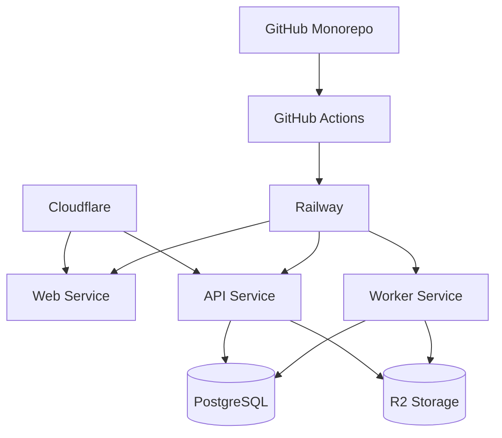

# Tinker Index — Technical Architecture

**Project:** Tinker Index  
**Primary domain:** https://tinkerindex.io  
**Secondary domain:** https://tinkerindex.app  
**Tagline:** Discover your next project.  
**Document version:** 1.0  
**Date:** November 11, 2026  
**Status:** Proposed implementation baseline — final configuration choices subject to verification

---

## 1. Executive Summary

Tinker Index is an AI-powered DIY project discovery platform that helps users find interesting projects based on their interests, skills, budget, available tools, and available time.

The platform discovers DIY projects from external creator websites and other approved sources, evaluates them using AI, and organizes them into a searchable catalog.

Each project page provides original analysis, structured project information, attribution to the original creator, and links to the source instructions.

The platform is designed for:

- Strong organic search performance.
- Fast, accessible public browsing.
- Low initial operating costs.
- Automated project discovery and evaluation.
- Human-controlled publishing at launch.
- Long-term automation with minimal manual intervention.
- Maintainable application code and infrastructure.

### Architectural philosophy

Build a modular monolith using familiar technologies.

Prefer straightforward, proven solutions over unnecessary infrastructure complexity.

The public website must function independently of the AI automation platform.

AI agents interact with the application through controlled, authenticated APIs and background jobs.

Search engine optimization is a foundational architectural concern.

---

## 2. Product Requirements

### 2.1 Public website

Visitors must be able to:

- Browse available DIY projects.
- Explore projects by category.
- Search projects by keywords.
- Filter projects by difficulty, cost, build time, and tools.
- View detailed project profiles.
- Follow links to original project instructions.
- Discover related projects.
- Browse on desktop, tablet, and mobile devices.

The initial release does not require visitor accounts.

### 2.2 Project information

Each published project should support:

- Title and unique URL slug.
- Original description and editorial summary.
- Project category and tags.
- Difficulty rating.
- Estimated cost and currency.
- Estimated completion time.
- Required tools.
- Required materials.
- Creator attribution.
- Original source URL.
- Main image and supporting images where permitted.
- Image attribution and licensing information.
- Source discovery date.
- Last reviewed date.
- Evaluation confidence and provenance.
- Publication status and timestamps.

AI-derived values must be distinguishable from source-verified values.

### 2.3 Editorial automation

The system must support:

- Project discovery.
- Duplicate detection.
- Source extraction.
- AI evaluation.
- Original content generation.
- Content validation.
- Editorial review.
- Publication.
- Re-evaluation of previously published content.

### 2.4 Business requirements

The platform should support display advertising as its primary revenue source.

Affiliate marketing may be added later.

The architecture must prioritize SEO, page speed, accessibility, and useful original content.

Advertising integrations must not compromise usability or Core Web Vitals.

---

## 3. Recommended Technology Stack

| Component | Technology | Decision |
|---|---|---|
| Frontend | Angular 21 | Retain as preferred baseline |
| Rendering | Angular hybrid SSR/SSG | Adopt |
| UI components | Angular Material | Retain selectively |
| Styling | SCSS | Retain |
| Language | TypeScript | Retain |
| Backend | NestJS 11 | Retain as preferred baseline |
| Runtime | Node.js LTS | Retain |
| API | REST | Retain |
| Database | PostgreSQL | Retain |
| ORM | Prisma | Retain; select supported major version before implementation |
| Search | PostgreSQL full-text search | Adopt initially |
| AI providers | Gemini and OpenAI | Retain |
| Agent orchestration | Hermes | External operational system |
| Hosting | Railway | Retain |
| DNS and CDN | Cloudflare | Retain |
| Media storage | Cloudflare R2 | Adopt |
| Package manager | pnpm | Retain |
| Repository | GitHub | Retain |
| Monorepo | pnpm workspaces | Adopt |
| Unit testing | Vitest and/or Jest | Select per framework integration |
| API testing | Supertest | Retain |
| End-to-end testing | Playwright | Adopt |
| Linting | ESLint | Retain |
| Formatting | Prettier | Retain |
| CI/CD | GitHub Actions + Railway | Adopt |

### Version policy

Before generating application code:

1. Verify currently supported stable releases.
2. Confirm Angular, TypeScript, Node.js, NestJS, and Prisma compatibility.
3. Prefer stable supported releases over prerelease versions.
4. Pin compatible dependency versions using the pnpm lockfile.
5. Document all final version selections.
6. Avoid unnecessary major-version upgrades during initial development.

Prisma 7 is a candidate for a new application, but its ESM, adapter, and configuration requirements must be considered. Prisma 6 remains an alternative if compatibility testing reveals a compelling reason.

Do not automatically install older versions simply because they appear in the reference stack.

---

## 4. High-Level Architecture

The application consists of five major components:

1. Angular public website and administrative interface.
2. NestJS backend API.
3. PostgreSQL database.
4. Background job processor.
5. External Hermes AI orchestration.

Cloudflare provides DNS, edge security, CDN capabilities, and object storage.

Railway hosts the application services and database.

### Architecture diagram



This diagram represents logical responsibilities.

The worker may share the same codebase and application modules as the backend while running as a separate Railway process.

No microservice infrastructure is required.

---

## 5. Frontend Architecture

### 5.1 Framework

Use Angular with standalone components and the framework's supported server-rendering capabilities.

Use SCSS for application styling.

Public website visual design, branding, typography, color tokens, and UI patterns are defined in [`style-guide.md`](style-guide.md). Treat that document as the visual source of truth; implement it through shared semantic SCSS/CSS variables rather than ad hoc component colors.

Use Angular Material selectively for accessible controls, administrative interfaces, dialogs, and forms.

Avoid allowing the default Angular Material appearance to dictate the public website's visual identity.

### 5.2 Rendering strategy

Use hybrid rendering.

| Page type | Recommended rendering |
|---|---|
| Home page | Prerender or SSR |
| Category landing pages | Prerender where practical |
| Project detail pages | SSR initially |
| Search results | SSR for useful canonical views |
| Interactive filtering | Client-side interaction |
| Administrative interface | Client-side rendering |
| Static information pages | Prerender |

Project pages must have complete, meaningful HTML available in the initial server response.

Search engines must not need to execute client-side JavaScript to discover essential project content.

Use SSR initially for dynamic project pages to avoid coupling publishing to full site rebuilds.

Prerender high-value pages or groups of stable pages when measurements justify the added build complexity.

Do not introduce a separate custom HTML metadata-injection server.

Use Angular's supported rendering and metadata mechanisms.

### 5.3 Frontend organization

Organize functionality into feature areas:

- Home and discovery.
- Project catalog.
- Project details.
- Categories.
- Search and filtering.
- Shared UI components.
- Administration.
- Core services and configuration.

Use lazy loading where appropriate.

Avoid introducing a global state-management library unless actual requirements justify it.

Use Angular's built-in reactive capabilities and RxJS where appropriate.

### 5.4 Performance requirements

The frontend should:

- Minimize JavaScript shipped to visitors.
- Avoid unnecessary client-side hydration.
- Optimize responsive images.
- Lazy-load below-the-fold images.
- Avoid layout shifts.
- Support caching for public content.
- Use semantic, accessible HTML.
- Minimize third-party scripts.

Core Web Vitals should be monitored after deployment.

---

## 6. Backend Architecture

### 6.1 Framework

Use NestJS as a modular monolithic backend.

Expose REST endpoints for public catalog access, administration, and agent workflows.

Keep business rules inside application services rather than controllers.

Use dependency injection and clear module boundaries.

### 6.2 Recommended modules

| Module | Responsibility |
|---|---|
| Projects | Project data and lifecycle |
| Categories | Category taxonomy |
| Search | Catalog queries and filters |
| Sources | External source records |
| Creators | Creator attribution |
| Evaluations | AI-generated assessments |
| Publishing | Editorial workflow |
| Media | Images, licenses, storage |
| Agents | Agent authentication and submissions |
| Jobs | Background processing |
| Auth | Administrator authentication |
| Admin | Administrative operations |
| SEO | Sitemap and metadata support |
| Health | Service health and readiness |

Modules may share a database, but should communicate through defined application services.

Avoid unnecessary abstraction layers.

### 6.3 API design

Use versioned REST endpoints.

Examples:

```text
GET    /api/v1/projects
GET    /api/v1/projects/:slug
GET    /api/v1/categories
GET    /api/v1/categories/:slug
GET    /api/v1/search

POST   /api/v1/agent/discoveries
GET    /api/v1/agent/jobs/:id

GET    /api/v1/admin/review-queue
POST   /api/v1/admin/projects/:id/approve
POST   /api/v1/admin/projects/:id/reject
POST   /api/v1/admin/projects/:id/publish
```

These are illustrative endpoint contracts, not a final API specification.

### 6.4 API standards

Implement:

- Request validation.
- Consistent error responses.
- Pagination with bounded page sizes.
- Stable sorting.
- Request correlation IDs.
- Structured logging.
- Authentication and authorization.
- Rate limiting.
- Explicit API versioning.

Generate an OpenAPI specification for development, testing, and agent integration.

Do not expose unpublished records through public endpoints.

---

## 7. Database Architecture

### 7.1 Database

Use PostgreSQL.

Use Prisma as the ORM and migration tool.

The database is the authoritative source for catalog, editorial, and operational state.

### 7.2 Core data concepts

The initial relational model should include:

| Entity | Purpose |
|---|---|
| Project | Canonical project record |
| Category | Project classification |
| Tag | Flexible categorization |
| Creator | Original project creator |
| Source | Source website and canonical URL |
| Discovery | Candidate project discovered by an agent |
| Tool | Normalized tool catalog |
| Material | Normalized material catalog |
| ProjectTool | Project-to-tool relationship |
| ProjectMaterial | Project-to-material relationship |
| Evaluation | AI assessment |
| ProjectRevision | Editorial revision history |
| MediaAsset | Image and file metadata |
| AgentJob | Background operation tracking |
| AdminUser | Administrative identity |

Additional join tables may be necessary.

Do not finalize the complete Prisma schema until entity relationships and lifecycle rules are reviewed.

### 7.3 Data provenance

Fields derived through AI evaluation should have enough metadata to identify:

- Source evidence.
- Evaluation model and version.
- Evaluation timestamp.
- Prompt or evaluation specification version.
- Confidence or uncertainty.
- Human verification status.

Source-verified facts must remain distinguishable from estimates.

### 7.4 Publication model

Use an explicit state machine.

Recommended states:

```text
DISCOVERED
    |
    v
EVALUATING
    |
    v
DRAFT
    |
    v
PENDING_REVIEW
    |
    +----> REJECTED
    |
    v
APPROVED
    |
    v
PUBLISHED
    |
    v
ARCHIVED
```

Allow failed evaluations to enter a retry or error state.

Publishing must validate required fields, attribution, source links, and media rights.

Approval and publication must be separate authorized operations, even if the administrator interface offers them together.

### 7.5 Search

Start with PostgreSQL full-text search.

Use indexed structured fields for filtering.

Support combinations of:

- Keywords.
- Category.
- Difficulty.
- Budget.
- Build time.
- Required tools.

Evaluate search quality before introducing an external search service.

Potential later enhancements include Meilisearch, Typesense, semantic search, and personalized recommendations.

No external search infrastructure is required at launch.

---

## 8. AI and Hermes Integration

### 8.1 Responsibilities

Hermes orchestrates project discovery and other AI-driven operational workflows.

The backend owns:

- Authentication.
- Validation.
- Authorization.
- Persistence.
- Publication rules.
- Job status.
- Audit records.

AI providers perform text extraction, analysis, and content generation as requested by controlled workflows.

### 8.2 Initial project sourcing

Start with curated maker websites and creator sources.

Do not implement uncontrolled internet-wide scraping at launch.

Maintain a curated source list.

Respect website terms, access restrictions, and crawl policies.

Do not bypass access controls or technical restrictions.

### 8.3 Agent workflow



### 8.4 Security boundaries

Hermes must never connect directly to production PostgreSQL.

Hermes must not possess database administrator credentials.

Agent submissions must pass through authenticated API endpoints.

Apply narrow permissions to agent identities.

Use separate credentials for discovery and privileged operations.

At launch, agents cannot approve or publish projects independently.

Publishing requires an authenticated human administrator.

All agent activities must be logged and attributable.

### 8.5 Job processing

Use database-backed jobs initially.

A dedicated Railway worker process can poll or claim pending jobs using transactional locking.

Job processing should support:

- Idempotency.
- Retry limits.
- Backoff.
- Failure states.
- Operation timeouts.
- Concurrency controls.
- Status tracking.
- Administrative retry.

Do not introduce Redis or a distributed message broker at launch unless demonstrated workload requires it.

Long-running AI requests should not block public HTTP requests.

### 8.6 AI provider abstraction

Keep AI-provider integration behind application services.

Store model configuration outside business logic.

Allow different providers for different workloads.

Use inexpensive models for straightforward classification and extraction where accuracy is sufficient.

Reserve more expensive models for tasks requiring stronger reasoning or generation quality.

Track token usage, failures, and estimated costs per job.

Apply budget limits and request timeouts.

### 8.7 Future autonomy

After proving editorial reliability, consider:

- Automated approval for low-risk changes.
- Source reputation scoring.
- Automated stale-content reviews.
- Automatic broken-link detection.
- Automated SEO quality checks.
- Periodic project re-evaluation.

Publishing autonomy must be introduced gradually, with measurable quality thresholds and rollback controls.

---

## 9. Content and Media Management

### 9.1 Editorial content

Each project page must provide useful original analysis.

Do not simply reproduce source instructions.

Provide attribution and direct links to original creators.

Do not imply that linking to a page grants permission to reproduce its images, diagrams, or text.

Store meaningful project revisions and editorial history.

### 9.2 Image storage

Use Cloudflare R2 for images the platform is authorized to store and serve.

Store:

- Storage object key.
- Source URL.
- Attribution.
- Rights holder where known.
- License type or permission basis.
- License evidence/reference.
- Usage restrictions.
- Image dimensions.
- Upload and review timestamps.

At launch, prefer licensed or explicitly source-authorized images and branded placeholders.

Do not automatically download and republish discovered images.

A source image URL alone does not establish reuse rights.

### 9.3 Image delivery

Serve authorized public images through a dedicated Cloudflare-backed media domain where practical.

Use responsive formats and dimensions.

Cache immutable image versions aggressively.

Avoid creating a general-purpose remote image proxy that can fetch arbitrary URLs.

### 9.4 Content validation

Before publication:

- Verify required metadata.
- Check source link validity.
- Check for duplicate projects.
- Check content completeness.
- Review unsupported factual claims.
- Verify media permissions.
- Confirm original analysis adds value.
- Validate public page metadata.

Human review is mandatory for the initial release.

---

## 10. SEO Architecture

SEO is a first-class requirement.

### 10.1 URL structure

Recommended URLs:

```text
/
 /projects
 /projects/:slug
 /categories/:slug
 /search
 /about
 /privacy
```

The primary canonical domain is:

https://tinkerindex.io

Redirect the secondary domain and alternate host variants to the corresponding canonical URLs using permanent redirects.

### 10.2 Metadata

Generate project-specific:

- Title tags.
- Meta descriptions.
- Canonical URLs.
- Open Graph metadata.
- Social sharing metadata.
- Structured data where appropriate.

Never rely on a shared generic page title for project content.

### 10.3 Crawlability

Project pages must provide server-rendered HTML containing:

- Project title.
- Project description.
- Primary project facts.
- Category links.
- Creator attribution.
- Source link.
- Relevant internal links.

Public links should use real anchor elements.

Avoid relying exclusively on client-side navigation for discoverability.

### 10.4 Structured data

Evaluate appropriate Schema.org types, including:

- WebSite.
- Organization.
- BreadcrumbList.
- Article.
- ItemList.

Use structured data only when it accurately represents visible page content.

Do not assume every project qualifies for HowTo rich results.

Do not invent ratings, reviews, prices, or other structured data.

### 10.5 Sitemaps

Generate XML sitemaps from published, indexable projects.

Include canonical project and category URLs.

Use accurate last-modified timestamps based on meaningful content changes.

Split sitemaps as the catalog grows.

Exclude drafts, rejected projects, administrative URLs, and unsuitable filter combinations.

### 10.6 Search and filter indexing

Keep public category pages indexable when they provide useful unique content.

Use canonical URLs and indexing rules to avoid large numbers of duplicate filter pages.

Internal keyword-search results should normally be excluded from indexing.

Do not automatically make every possible search and filter combination crawlable.

### 10.7 SEO quality

Monitor:

- Indexed pages.
- Search impressions.
- Organic clicks.
- Search queries.
- Core Web Vitals.
- Crawl errors.
- Broken links.
- Duplicate metadata.
- Pages with thin or repetitive content.

Use Google Search Console from launch.

Add web analytics with an appropriate privacy configuration.

---

## 11. Infrastructure and Deployment

### 11.1 Hosting

Use Railway for:

- Angular web application.
- NestJS API.
- Background worker.
- PostgreSQL database.

Use Cloudflare for:

- DNS.
- HTTPS edge services.
- CDN and caching.
- WAF and edge rate limiting.
- R2 object storage.
- Domain redirects.

### 11.2 Service topology



Use separate Railway service configurations while maintaining one source repository.

### 11.3 Environments

Use at minimum:

- Local development.
- Production.

Use a staging environment before launch and whenever testing requires production-like infrastructure.

Development and production must not share database credentials or writable storage namespaces.

### 11.4 Deployment workflow

1. Changes are developed locally in Cursor.
2. Automated tests run locally.
3. Code is committed to GitHub.
4. GitHub Actions runs validation.
5. Approved changes are merged.
6. Railway deploys the affected services.
7. Health checks confirm service readiness.
8. Application and SEO smoke tests verify deployment.

Use branch protection and automated checks on the main branch.

Avoid automatic production database migrations from multiple application replicas.

Run migrations through a controlled deployment step.

### 11.5 Cloudflare configuration

Configure:

- DNS for the primary domain.
- HTTPS.
- Redirects for secondary and alternate domains.
- WAF rules.
- Appropriate request rate limits.
- Static asset caching.
- Media caching.

Avoid indiscriminately caching authenticated content.

Cache public HTML conservatively until invalidation behavior is proven.

Do not cache administrative or personalized responses publicly.

### 11.6 Backups and recovery

Provide:

- Automated PostgreSQL backups.
- Documented database restore procedures.
- R2 object recovery strategy.
- Environment configuration backup documentation.
- Deployment rollback capability.

Verify backup and restore behavior before production launch.

---

## 12. Security Architecture

### 12.1 Public website

Public browsing does not require authentication.

All public API inputs must be validated.

Apply rate limits to expensive or abuse-prone endpoints.

Use safe query construction and enforce database access through application services.

### 12.2 Administrative access

Administrative functions require authentication.

Use established authentication mechanisms rather than building custom password handling.

Require strong authentication and preferably MFA.

Apply role-based authorization.

Administrators alone can approve and publish content at launch.

### 12.3 Agent access

Use distinct agent identities and scoped credentials.

Do not share administrative credentials with Hermes.

Store agent credentials in secure environment variables or secret management.

Support credential rotation and revocation.

Validate all agent payloads server-side.

Maintain an audit trail of agent actions and editorial decisions.

### 12.4 External content security

Treat discovered webpage text and AI output as untrusted input.

Protect against prompt injection within source content.

Do not execute instructions found in discovered content.

Prevent server-side request forgery in URL fetching.

Restrict network destinations and reject unsafe local/private network targets.

Sanitize generated content before rendering.

Do not allow arbitrary HTML or script execution in project descriptions.

### 12.5 Secrets

Never commit API keys, database passwords, or credentials.

Use Railway-managed environment variables for deployed services.

Use ignored local environment files during development.

Do not expose server-side secrets to Angular browser bundles.

---

## 13. Repository Structure

Use a single GitHub monorepo with pnpm workspaces.

Recommended structure:

```text
tinker-index/
├── apps/
│   ├── web/
│   │   └── Angular application
│   ├── api/
│   │   └── NestJS API
│   └── worker/
│       └── Background job entry point
│
├── packages/
│   └── contracts/
│       └── Shared API types and validation contracts
│
├── docs/
│   ├── architecture.md
│   ├── style-guide.md
│   ├── implementation-plan.md
│   └── decisions/
│
├── scripts/
│
├── .github/
│   └── workflows/
│
├── AGENTS.md
├── package.json
├── pnpm-workspace.yaml
├── pnpm-lock.yaml
├── .gitignore
├── .editorconfig
└── README.md
```

The database schema and migrations should initially live with the backend's data-access configuration.

Do not create separate packages unless sharing or isolation justifies them.

The worker should reuse backend business services or shared application modules where practical.

Avoid a second independent implementation of the same business logic.

### Repository principles

- One repository.
- One package manager.
- One lockfile.
- Clear application boundaries.
- Shared contracts where useful.
- Independent Railway deployment targets.
- No unnecessary monorepo build framework.

Add Nx, Turborepo, or another orchestration tool only if pnpm workspaces and ordinary scripts become insufficient.

---

## 14. Testing Strategy

### 14.1 Unit tests

Test:

- Project validation.
- Difficulty and cost normalization.
- Business rules.
- Publishing state transitions.
- Search filtering.
- Agent authorization.
- Content validation.

### 14.2 Integration tests

Test:

- NestJS API endpoints.
- PostgreSQL repository operations.
- Prisma migrations.
- Job state transitions.
- Authentication and authorization.
- Agent submission workflows.

### 14.3 End-to-end tests

Use Playwright for critical browser flows.

Initial scenarios:

1. Visit the home page.
2. Browse a category.
3. Search and filter projects.
4. Open a project detail page.
5. Follow an original source link.
6. Authenticate as an administrator.
7. Review and publish a project.

### 14.4 SEO tests

Validate:

- Server-generated page HTML.
- Correct title and meta description.
- Canonical URLs.
- Structured data.
- Sitemap entries.
- Noindex rules.
- Redirect behavior.
- Proper HTTP status codes for missing projects.

### 14.5 CI requirements

Pull requests should run appropriate linting, type checks, and tests.

Build failures must block merges.

Deployment smoke tests should verify the public site and API.

---

## 15. MVP Scope

The initial production release should support:

- Public home page.
- Project catalog.
- Category pages.
- Project detail pages.
- Keyword search.
- Filtering by primary project attributes.
- Original creator attribution.
- External source links.
- SEO metadata and sitemap.
- Administrative authentication.
- Basic editorial review and publishing.
- PostgreSQL persistence.
- Initial Hermes discovery/evaluation integration.
- Basic monitoring, error logging, and backups.

### Initial catalog

Target 50–150 curated, reviewed projects.

Prioritize quality and variety over raw project volume.

### Explicit launch decisions

- Discovery begins with curated websites and creator sources.
- Project pages contain original analysis and external instruction links.
- Human approval is required for every project.
- Images must be authorized for reuse or replaced with branded placeholders.
- Launch target is 50–150 curated projects.
- Visitors do not need accounts.

### Excluded from MVP

Do not initially build:

- Visitor account management.
- Personalized recommendation models.
- User project submissions.
- Community discussions.
- User ratings and reviews.
- Complex affiliate attribution.
- Dedicated search infrastructure.
- Redis-based distributed queues.
- Microservices.
- Fully autonomous publishing.
- An elaborate multi-agent operations dashboard.

These may become future enhancements based on demonstrated demand.

---

## 16. Implementation Phases

### Phase 1 — Repository foundation

Establish:

- Monorepo.
- Angular application.
- NestJS application.
- Worker entry point.
- Shared configuration.
- Development tooling.
- Testing infrastructure.
- Documentation and persistent agent instructions.

**Acceptance criterion:** The repository installs, builds, and runs its initial validation checks successfully.

### Phase 2 — Backend and database foundation

Implement:

- PostgreSQL connection.
- Prisma configuration and migrations.
- Core project entities.
- Basic catalog APIs.
- Seed data for development.
- Health endpoints.

**Acceptance criterion:** Sample project data can be retrieved through the API.

### Phase 3 — Public website

Implement:

- Visual design foundation per [`style-guide.md`](style-guide.md).
- Home page.
- Project listing.
- Project details.
- Category browsing.
- Search and filters.
- Server rendering.
- Basic SEO metadata.

**Acceptance criterion:** A visitor can discover and view projects in a complete local application.

### Phase 4 — Editorial workflow

Implement:

- Administrator access.
- Draft management.
- Review queue.
- Approval and publishing.
- Content revisions.
- Attribution and media validation.

**Acceptance criterion:** An authorized administrator can review and publish a project.

### Phase 5 — Hermes integration

Implement:

- Agent authentication.
- Discovery submissions.
- Deduplication.
- Job processing.
- AI evaluation.
- Human review integration.
- Cost and failure tracking.

**Acceptance criterion:** Hermes can submit a discovery and produce a reviewable draft without accessing the database directly or publishing it.

### Phase 6 — Production deployment

Implement:

- Railway services.
- PostgreSQL configuration.
- Cloudflare DNS.
- R2 storage.
- CI/CD.
- Monitoring.
- Backups.
- Security checks.
- SEO validation.

**Acceptance criterion:** The production website is publicly accessible, stable, and indexable.

### Phase 7 — Catalog launch

Curate and publish the initial 50–150 projects.

Verify:

- Project accuracy.
- Attribution.
- Media rights.
- Search usability.
- Page performance.
- Sitemap coverage.
- Search Console integration.

---

## 17. Operational and Financial Constraints

Keep infrastructure spending low during the validation stage.

Control cost through:

- Small Railway service footprints.
- Minimal always-on background processing.
- Database-backed jobs.
- No dedicated search cluster.
- No Redis unless justified.
- Cloudflare static asset caching.
- Efficient image storage.
- AI usage limits.
- Batch discovery.
- Controlled evaluation frequency.
- Model selection based on task complexity.

Monitor monthly:

- Railway compute usage.
- Database storage.
- R2 storage and operations.
- AI API costs.
- Background job volume.
- Public traffic.
- Search performance.

Avoid scaling infrastructure in anticipation of demand that has not yet appeared.

---

## 18. Risks and Trade-offs

### Search-engine indexing

**Risk:** Search engines may not index large numbers of low-value project pages.

**Mitigation:** Publish original, useful content; maintain good internal linking; avoid thin, repetitive pages; monitor indexing.

### AI-generated inaccuracies

**Risk:** AI estimates may be incorrect.

**Mitigation:** Preserve provenance, label estimates, validate claims, require editorial review.

### Copyright and media usage

**Risk:** Reusing third-party content without permission creates legal and reputational exposure.

**Mitigation:** Preserve attribution, use original analysis, store license evidence, avoid unauthorized image copying.

### Automation reliability

**Risk:** Agent workflows may fail, duplicate work, or produce inconsistent content.

**Mitigation:** Use durable job states, idempotency, retries, audit logs, and human approval.

### AI operating costs

**Risk:** Continuous discovery and evaluation may become expensive.

**Mitigation:** Use budgets, bounded job frequency, lower-cost models, and evaluation prioritization.

### Infrastructure complexity

**Risk:** Premature architectural complexity increases cost and maintenance burden.

**Mitigation:** Keep a modular monolith, pnpm workspaces, PostgreSQL search, and limited Railway services.

### SSR availability and performance

**Risk:** Slow or unavailable API responses may affect server-rendered pages.

**Mitigation:** Use timeouts, caching, health monitoring, and efficient read queries.

---

## 19. Open Decisions Before Implementation

The following choices must be confirmed before their corresponding implementation phase:

1. Final compatible framework and runtime versions.
2. Angular SSR deployment configuration and caching policy.
3. Administrator authentication provider and MFA strategy.
4. Database-backed job implementation details.
5. Initial project difficulty scale and cost/time estimation rules.
6. Initial category taxonomy and tag conventions.
7. AI provider and model assignments by workload.
8. Exact source ingestion policies and licensing evidence requirements.
9. Application visual design and branding — resolved in [`style-guide.md`](style-guide.md) (Maker Discovery).
10. Budget limits for hosting and AI operations.
11. Local and staging environment requirements.
12. Detailed data model and API contracts.

These decisions should be documented in architecture decision records when resolved.

Do not silently invent major requirements during implementation.

---

## 20. Instructions for AI-Assisted Development

This document is the authoritative technical architecture for Tinker Index until formally revised.

When using Cursor or other AI coding tools:

1. Read this document before implementation.
2. Follow the approved technology decisions.
3. For public website UI and branding, follow [`style-guide.md`](style-guide.md); do not invent a competing visual system.
4. Avoid introducing frameworks or services not justified by requirements.
5. Work in small, verifiable milestones.
6. Explain proposed architectural deviations before implementing them.
7. Write tests for important business logic.
8. Preserve clean module boundaries.
9. Never hardcode credentials.
10. Never give agents unrestricted production database access.
11. Protect SEO and server rendering throughout frontend development.
12. Distinguish source facts from AI-derived estimates.
13. Respect copyright and media licensing constraints.
14. Do not implement future enhancements during the MVP unless explicitly requested.
15. Do not begin the next milestone before the current one is verified.

### Development quality standard

The goal is a maintainable, cost-effective, production-ready application.

Avoid overengineering.

Prefer readable, conventional code and well-supported dependencies.

Make architectural changes intentionally, document the reasoning, and keep implementation aligned with the product's business requirements.

---

## 21. Definition of Architectural Success

The architecture is successful when:

- Visitors can quickly discover relevant DIY projects.
- Public pages are fast, crawlable, and indexable.
- Content is original, accurate, and properly attributed.
- Hermes can reliably discover and evaluate candidate projects.
- Agents cannot bypass application security or editorial controls.
- New project pages can be published without rebuilding the entire application.
- The system operates at reasonable cost with low traffic.
- The application can scale without a complete rewrite.
- One developer, assisted by AI tools, can maintain and extend the system.

**Tinker Index should begin as a simple, high-quality discovery platform and evolve into an increasingly automated maker-project catalog as demand and operational confidence grow.**